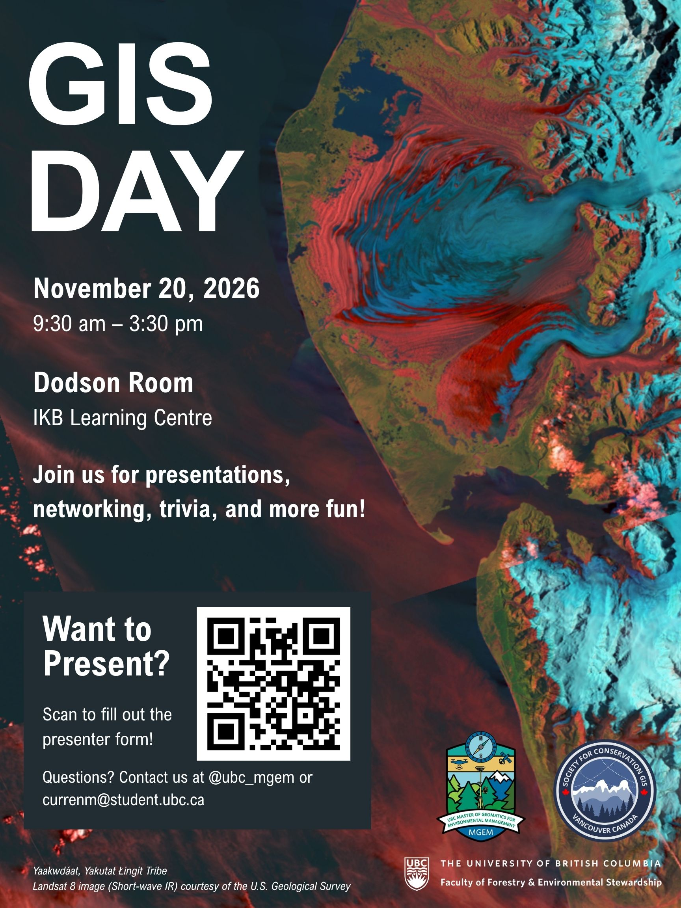

::: centered-page-content
Join us on **November 20** for UBC GIS Day 2026, co-hosted by the SCGIS Vancouver Chapter and UBC's Master of Geomatics for Environmental Management (MGEM) program!

**Date & Time:** Nov 20, 2026 - 9:30 to 15:30

**Location:** Dodson Room (302) in the Irving K. Barver LearninStart-Process "D:\github\scgis-canada-vancouver.github.io\docs\events\\2026-11-gis-day.html"g Centre, 1961 East Mall, Vancouver

This event brings together UBC faculty, staff, students, and SCGIS members to share their ongoing research, projects, and applications of Geographic Information Systems (GIS). Whether you're presenting your work or simply interested in learning about the geospatial community, everyone is welcome to attend, connect, and exchange ideas.

**Interested in presenting?** Sign up to give a talk or showcase your work using the presentation [registration link](https://docs.google.com/forms/d/e/1FAIpQLSet5z7iHY5phWPE-zOEnwe8Q1cR8Ta3-ggRekmGokzQCW8emQ/viewform). (The deadline for presentation inquiries is Nov 20.)

We will also be announcing the winner of the [Maps for Conservation](2026-11-maps-for-conservation.qmd) competition during the event!

We look forward to seeing you there!

:::