::: map-gallery
Thank you to everyone who entered the [Maps for Conservation](2026-11-maps-for-conservation.qmd) competition! We received 13 maps covering pollinators in Vancouver, sea ice in the Arctic, and much more. Every submission is shown below with the description its mapmaker wrote.

Select a map to jump to it, then click the image to view it full screen.

```{=html}
<div class="map-grid">
  <a class="map-card" href="#map-01">
    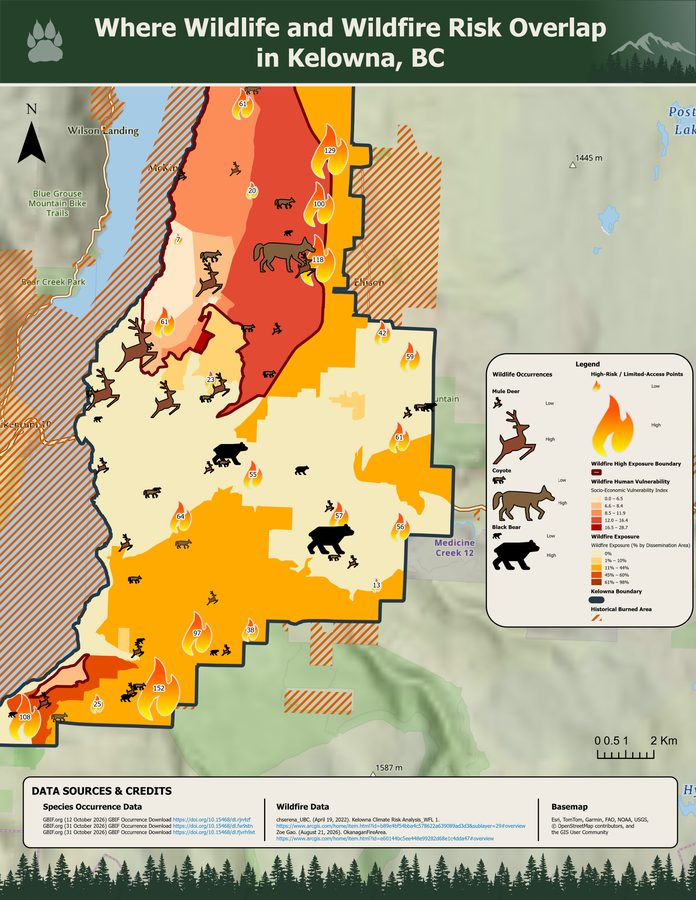
    <span class="map-card-body"><span class="map-card-num">Map 1</span><span class="map-card-title">Where Wildlife and Wildfire Risk Overlap in Kelowna, BC</span><span class="map-card-loc">Kelowna, BC</span></span>
  </a>
  <a class="map-card" href="#map-02">
    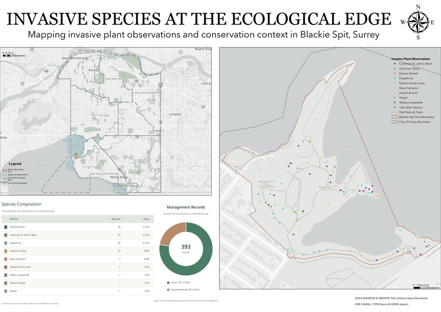
    <span class="map-card-body"><span class="map-card-num">Map 2</span><span class="map-card-title">Invasive Species at the Ecological Edge</span><span class="map-card-loc">Surrey, BC</span></span>
  </a>
  <a class="map-card" href="#map-03">
    
    <span class="map-card-body"><span class="map-card-num">Map 3</span><span class="map-card-title">The Regreening of Greater Sudbury in Two Snapshots</span><span class="map-card-loc">Greater Sudbury, ON</span></span>
  </a>
  <a class="map-card" href="#map-04">
    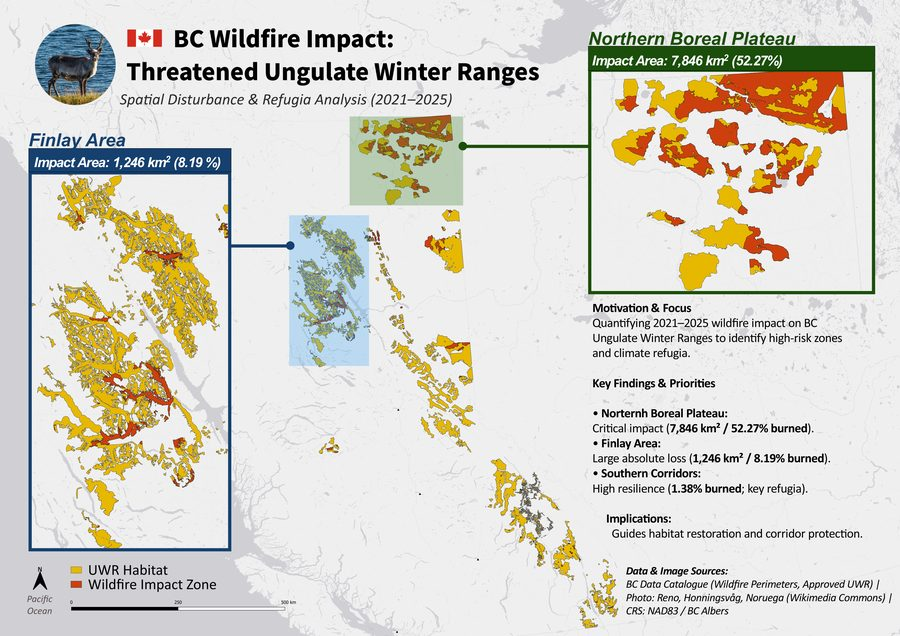
    <span class="map-card-body"><span class="map-card-num">Map 4</span><span class="map-card-title">BC Wildfire Impact: Threatened Ungulate Winter Ranges</span><span class="map-card-loc">British Columbia</span></span>
  </a>
  <a class="map-card" href="#map-05">
    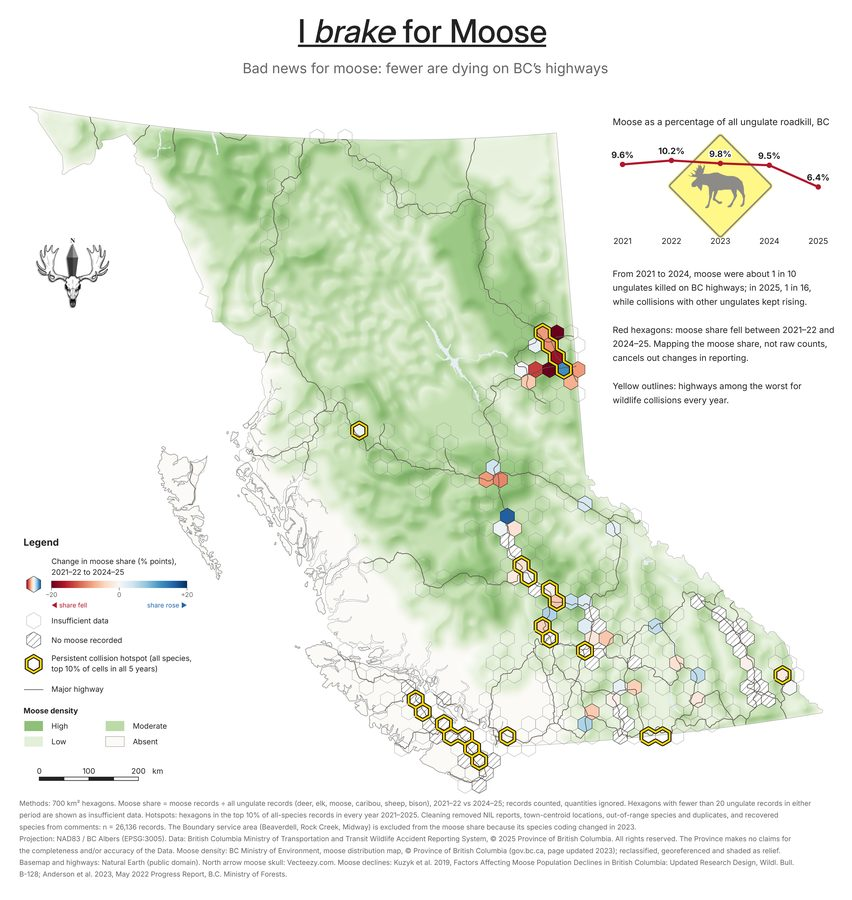
    <span class="map-card-body"><span class="map-card-num">Map 5</span><span class="map-card-title">I Brake for Moose</span><span class="map-card-loc">British Columbia</span></span>
  </a>
  <a class="map-card" href="#map-06">
    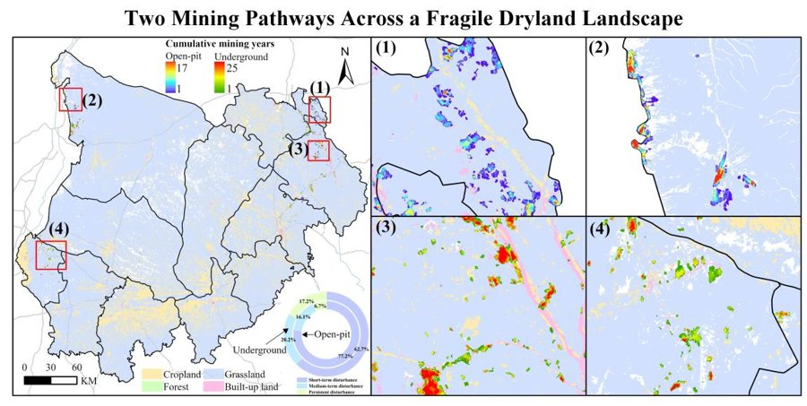
    <span class="map-card-body"><span class="map-card-num">Map 6</span><span class="map-card-title">Two Mining Pathways Across a Fragile Dryland Landscape</span><span class="map-card-loc">Mu Us Sandy Land, China</span></span>
  </a>
  <a class="map-card" href="#map-07">
    
    <span class="map-card-body"><span class="map-card-num">Map 7</span><span class="map-card-title">Bumble Bee Occurrence and Green Space in Vancouver</span><span class="map-card-loc">Vancouver, BC</span></span>
  </a>
  <a class="map-card" href="#map-08">
    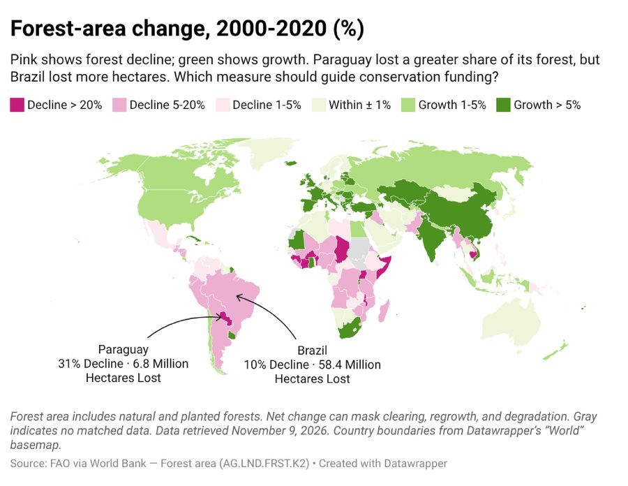
    <span class="map-card-body"><span class="map-card-num">Map 8</span><span class="map-card-title">Forest-Area Change, 2000–2020: Paraguay and Brazil in Global Context</span><span class="map-card-loc">Global</span></span>
  </a>
  <a class="map-card" href="#map-09">
    
    <span class="map-card-body"><span class="map-card-num">Map 9</span><span class="map-card-title">Not All Marmots Get the Same Summer!</span><span class="map-card-loc">Whistler, BC</span></span>
  </a>
  <a class="map-card" href="#map-10">
    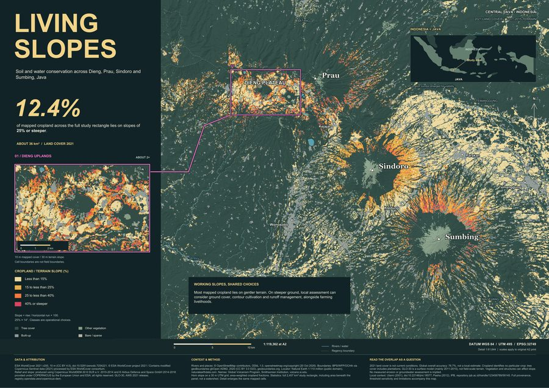
    <span class="map-card-body"><span class="map-card-num">Map 10</span><span class="map-card-title">Living Slopes</span><span class="map-card-loc">Central Java, Indonesia</span></span>
  </a>
  <a class="map-card" href="#map-11">
    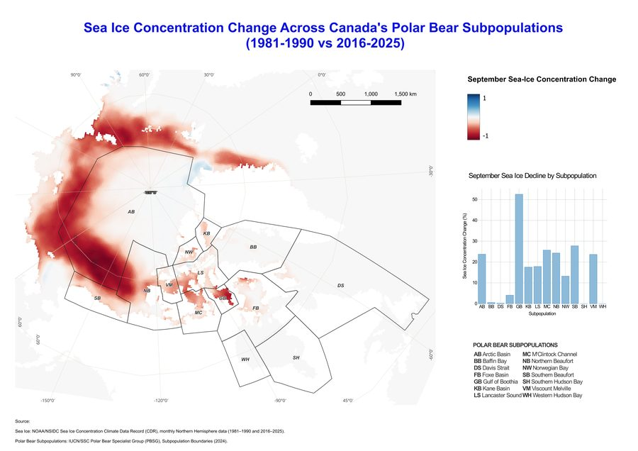
    <span class="map-card-body"><span class="map-card-num">Map 11</span><span class="map-card-title">Sea Ice Concentration Change Across Canada&#x27;s Polar Bear Subpopulations</span><span class="map-card-loc">Canadian Arctic</span></span>
  </a>
  <a class="map-card" href="#map-12">
    
    <span class="map-card-body"><span class="map-card-num">Map 12</span><span class="map-card-title">Average Age of Trees on Southwest Vancouver Island</span><span class="map-card-loc">Vancouver Island, BC</span></span>
  </a>
  <a class="map-card" href="#map-13">
    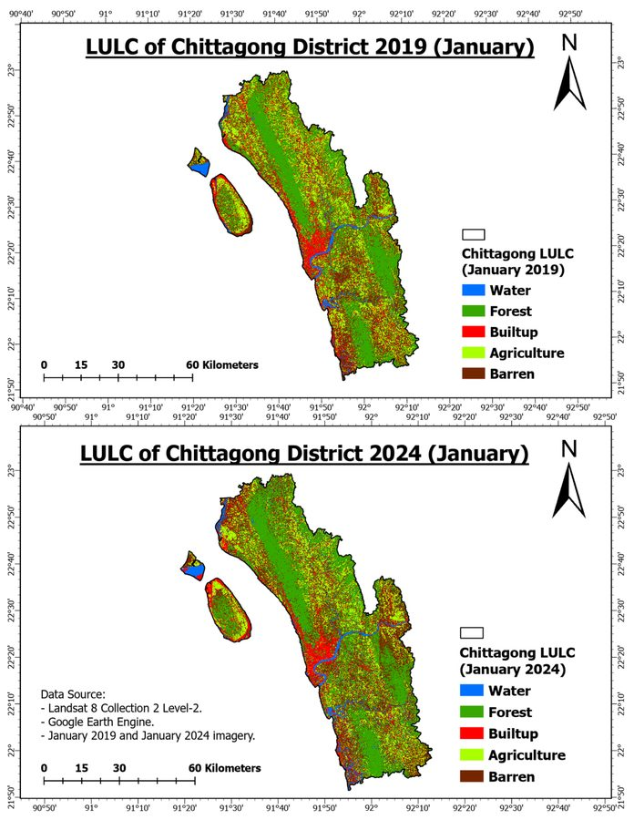
    <span class="map-card-body"><span class="map-card-num">Map 13</span><span class="map-card-title">Land Use and Land Cover Dynamics in Chittagong District (2019–2024)</span><span class="map-card-loc">Chittagong, Bangladesh</span></span>
  </a>
</div>
```

::: {#map-01 .map-entry}
## Where Wildlife and Wildfire Risk Overlap in Kelowna, BC {.unnumbered}

[Map 1 · Kelowna, BC]{.map-entry-meta}

```{=html}
<a href="../img/events/maps_for_conservation/map-08.jpg" class="map-figure" data-gallery="maps" data-glightbox="title: Map 1: Where Wildlife and Wildfire Risk Overlap in Kelowna, BC">
  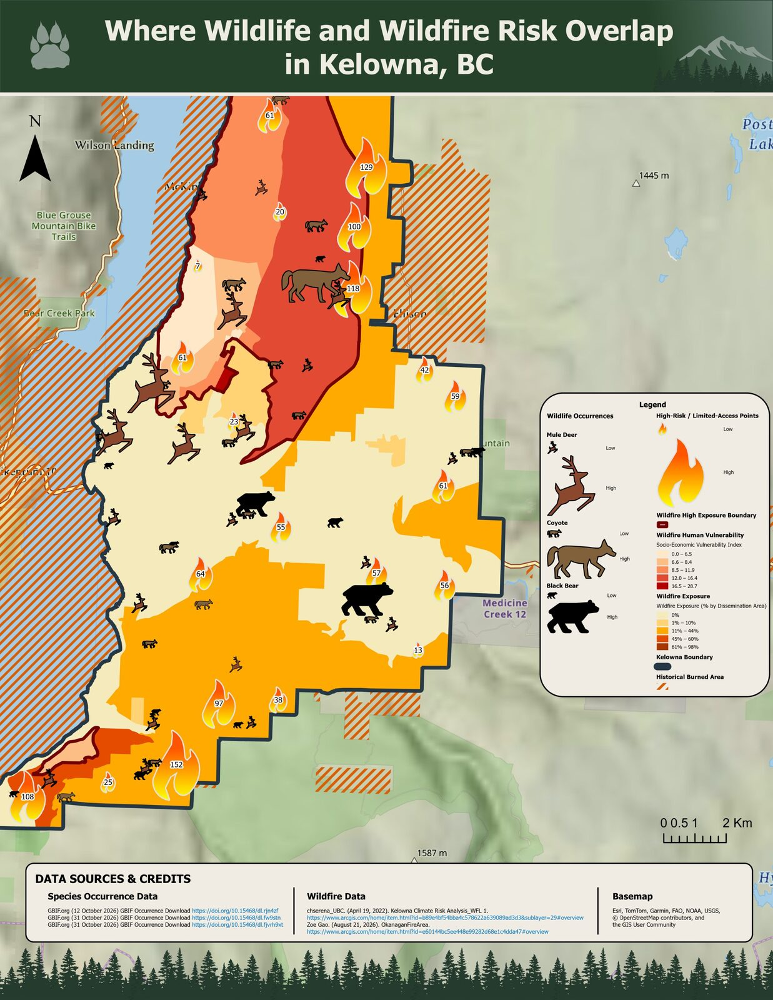
</a>
```

::: map-entry-text
This map illustrates the intersection of wildlife conservation, wildfire hazards, and human socioeconomic vulnerability in Kelowna, British Columbia, by combining a decade of documented occurrences (2016--2026) for coyotes, black bears, and mule deer with wildfire exposure data. Historical burned areas provide context on past wildfire activity, while identified limited-access points highlight locations where accessibility could complicate emergency response and wildlife protection during wildfire events. Together, these layers reveal a shared crisis: human communities and regional wildlife occupy many of the same landscapes, where wildfire hazards can threaten both. While communities may face unequal challenges preparing for, responding to, and recovering from wildfires, wildlife faces distinct threats, including habitat loss, reduced food and shelter availability, disrupted movement, and direct mortality. Areas where mammal occurrences coincide with high wildfire hazards highlight locations that warrant particular attention in conservation planning. As climate change intensifies hot and dry conditions that can contribute to more severe wildfire seasons, regional mitigation strategies must consider wildlife protection alongside human safety, recognizing that safeguarding biodiversity and habitats deserves equal consideration in wildfire planning.

[Open full-resolution image](../img/events/maps_for_conservation/map-08.jpg){target="_blank"} · [Back to top](#){.back-top}
:::
:::

::: {#map-02 .map-entry}
## Invasive Species at the Ecological Edge {.unnumbered}

[Map 2 · Surrey, BC]{.map-entry-meta}

```{=html}
<a href="../img/events/maps_for_conservation/map-12.jpg" class="map-figure" data-gallery="maps" data-glightbox="title: Map 2: Invasive Species at the Ecological Edge">
  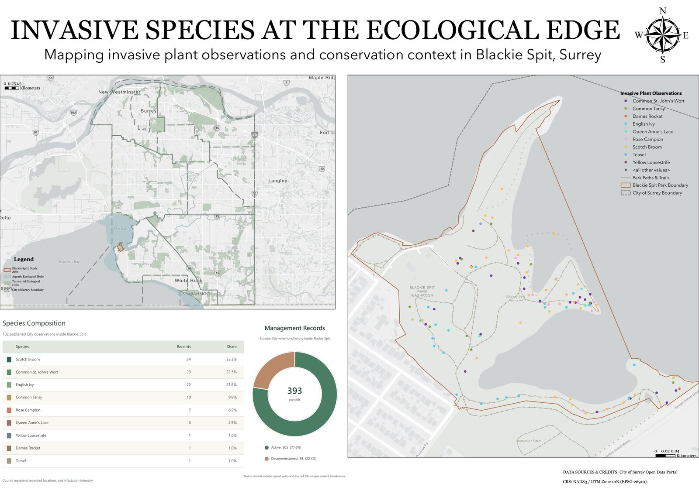
</a>
```

::: map-entry-text
Located along Surrey's coastline, Blackie Spit is part of an ecologically significant landscape where terrestrial and aquatic habitats meet. These connected environments support local biodiversity, while invasive plants present an ongoing challenge for habitat stewardship.

This map examines the spatial distribution of invasive plant observations within Blackie Spit Park in the context of Surrey's broader ecological network. Using City of Surrey GIS data, it presents 102 observations from a published municipal subset, representing nine plant species, including Scotch Broom, Common St. John's Wort, English Ivy, and Common Tansy. The accompanying ecological context map situated the park within mapped terrestrial and aquatic ecological hubs.

The map is intended to make spatial conservation information accessible and illustrate how local observations can inform awareness of invasive plants in coastal habitats. The observations do not represent a complete inventory of the park's current invasive plant coverage, and differences in recorded counts should not be interpreted as measures of infestation severity.

[Open full-resolution image](../img/events/maps_for_conservation/map-12.jpg){target="_blank"} · [Back to top](#){.back-top}
:::
:::

::: {#map-03 .map-entry}
## The Regreening of Greater Sudbury in Two Snapshots {.unnumbered}

[Map 3 · Greater Sudbury, ON]{.map-entry-meta}

```{=html}
<a href="../img/events/maps_for_conservation/map-04.jpg" class="map-figure" data-gallery="maps" data-glightbox="title: Map 3: The Regreening of Greater Sudbury in Two Snapshots">
  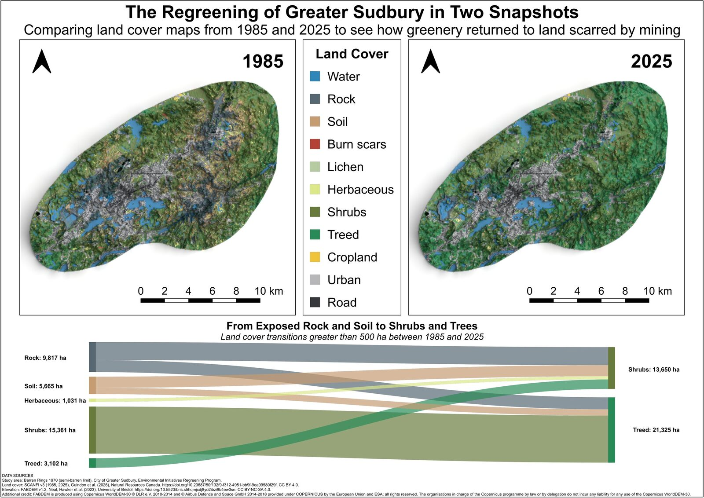
</a>
```

::: map-entry-text
For decades, exposed rock and thin soils were among the most visible signs of Greater Sudbury's mining and smelting legacy. Getting plants to take root again was one of the first challenges. The municipal Regreening Program began in 1978. Crews spread crushed limestone to reduce soil acidity, seeded barren ground, and planted trees. Volunteers joined the effort as the work continued over the following decades.

The map covers the barren and semi-barren areas of Greater Sudbury as mapped in 1970. It compares 1985 and 2025, the earliest and latest years in Natural Resources Canada's SCANFI v3 land cover dataset. In 1985, seven years after the program began, patches of exposed rock and soil still stood out among the hills and lakes. By 2025, shrubs and trees covered many of those same places. Side by side, the snapshots let readers follow the return of greenery on land scarred by mining.

Greater Sudbury's regreening has earned international recognition as an example of successful large-scale landscape restoration in a region shaped by more than a century of mining and smelting. Its story offers a hopeful view of what recovery can look like on land where vegetation once struggled to grow.

[Open full-resolution image](../img/events/maps_for_conservation/map-04.jpg){target="_blank"} · [Back to top](#){.back-top}
:::
:::

::: {#map-04 .map-entry}
## BC Wildfire Impact: Threatened Ungulate Winter Ranges {.unnumbered}

[Map 4 · British Columbia]{.map-entry-meta}

```{=html}
<a href="../img/events/maps_for_conservation/map-07.jpg" class="map-figure" data-gallery="maps" data-glightbox="title: Map 4: BC Wildfire Impact: Threatened Ungulate Winter Ranges">
  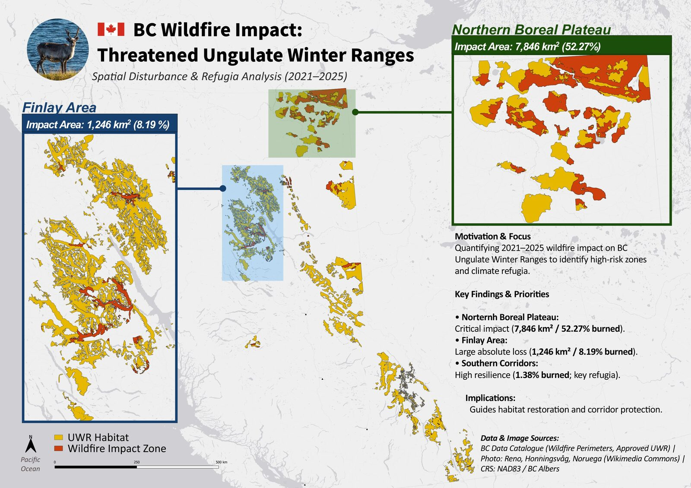
</a>
```

::: map-entry-text
**Project Abstract & Key Findings:** Quantifying 2021--2025 wildfire impacts on British Columbia's approved Ungulate Winter Ranges (UWR) is critical for pinpointing habitat fragmentation and identifying climate refugia. Spatial analysis reveals extreme regional variation: the Northern Boreal Plateau suffered critical degradation (7,846 km² / 52.27% burned), severely compromising winter canopy cover; the Finlay Area sustained high absolute loss (1,246 km² / 8.19% burned); while Southern Corridors demonstrated remarkable spatial resilience (1.38% burned), serving as essential winter refugia. By bridging fire ecology and landscape conservation, this project provides empirical evidence to guide prioritized post-fire habitat restoration, ecological monitoring, and corridor connectivity modeling across BC's mountain ungulate habitats.

**Technical & Data Attribution:**

- Data Sources: BC Data Catalogue (Wildfire Perimeters 2021--2025, Approved UWR)
- Image Attribution: Photo of Rangifer tarandus by Diego Delso (CC BY-SA 4.0 via Wikimedia Commons)

[Open full-resolution image](../img/events/maps_for_conservation/map-07.jpg){target="_blank"} · [Back to top](#){.back-top}
:::
:::

::: {#map-05 .map-entry}
## I Brake for Moose {.unnumbered}

[Map 5 · British Columbia]{.map-entry-meta}

```{=html}
<a href="../img/events/maps_for_conservation/map-11.jpg" class="map-figure" data-gallery="maps" data-glightbox="title: Map 5: I Brake for Moose">
  
</a>
```

::: map-entry-text
Fewer moose are dying on BC's highways, and that's a warning sign.

In 2021, one in ten hoofed animals killed on BC roads was a moose. By 2025, it was one in sixteen, while collisions with other hoofed animals rose by nearly a third. October and November are peak season for wildlife collisions, so slow down at dawn and dusk, especially on the highways outlined in yellow. Brake for moose!

Why is fewer bad? The map shows the moose share of roadkill, not raw counts, which cancels out changes in how many collisions get reported. The share fell in 27 of the 45 hexagons with enough data, most clearly around Dawson Creek and Fort St. John. That matches provincial research showing moose declines of 50--70% in parts of the interior since the early 2000s.

Roadkill is only a rough signal; confirming trends takes direct counts. Thermal drone surveys with automated moose and deer detection are being developed to make those counts easier: <https://friresearch.ca/publications/eyes-in-the-sky-tracking-moose-with-drones>

About 5,000 dead animals are recorded on BC highways every year. Wildlife crossings, fencing and lower speeds on the worst stretches would save the most of them, moose included.

[Open full-resolution image](../img/events/maps_for_conservation/map-11.jpg){target="_blank"} · [Back to top](#){.back-top}
:::
:::

::: {#map-06 .map-entry}
## Two Mining Pathways Across a Fragile Dryland Landscape {.unnumbered}

[Map 6 · Mu Us Sandy Land, China]{.map-entry-meta}

```{=html}
<a href="../img/events/maps_for_conservation/map-09.jpg" class="map-figure" data-gallery="maps" data-glightbox="title: Map 6: Two Mining Pathways Across a Fragile Dryland Landscape">
  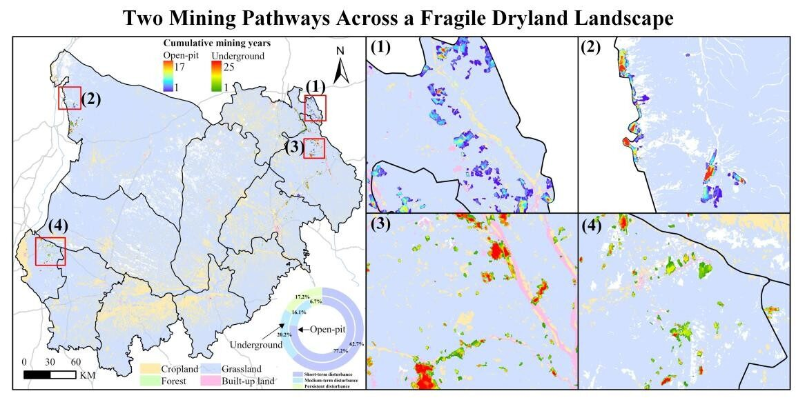
</a>
```

::: map-entry-text
Coal mining is reshaping land-use patterns across the Mu Us Sandy Land, a water-limited region where grasslands and other ecosystems coexist with intensive resource extraction. This map visualizes the spatial footprints and cumulative disturbance durations of open-pit and underground mining from 2000 to 2024, highlighting their contrasting patterns of expansion.

Areas with short cumulative disturbance durations (1--5 years) account for 77.2% of open-pit and 62.7% of underground mining footprints, highlighting the predominance of relatively short-duration disturbances across both mining modes. However, their spatial configurations differ markedly. Open-pit mining typically exhibits outward-expanding excavation fronts surrounding compact cores, whereas underground mining forms more dispersed clusters of surface infrastructure. Four enlarged views reveal these distinctive patterns within the surrounding land-cover mosaic.

These spatial contrasts have important implications for ecosystem conservation and land management. Mapping the location and persistence of mining footprints can help identify areas requiring closer environmental monitoring, inform land-use planning, and support targeted restoration strategies. By connecting mining histories with their geographic context, this map provides a spatial perspective on the challenges of balancing resource development and ecosystem protection in vulnerable dryland environments.

[Open full-resolution image](../img/events/maps_for_conservation/map-09.jpg){target="_blank"} · [Back to top](#){.back-top}
:::
:::

::: {#map-07 .map-entry}
## Bumble Bee Occurrence and Green Space in Vancouver {.unnumbered}

[Map 7 · Vancouver, BC]{.map-entry-meta}

```{=html}
<a href="../img/events/maps_for_conservation/map-02.jpg" class="map-figure" data-gallery="maps" data-glightbox="title: Map 7: Bumble Bee Occurrence and Green Space in Vancouver">
  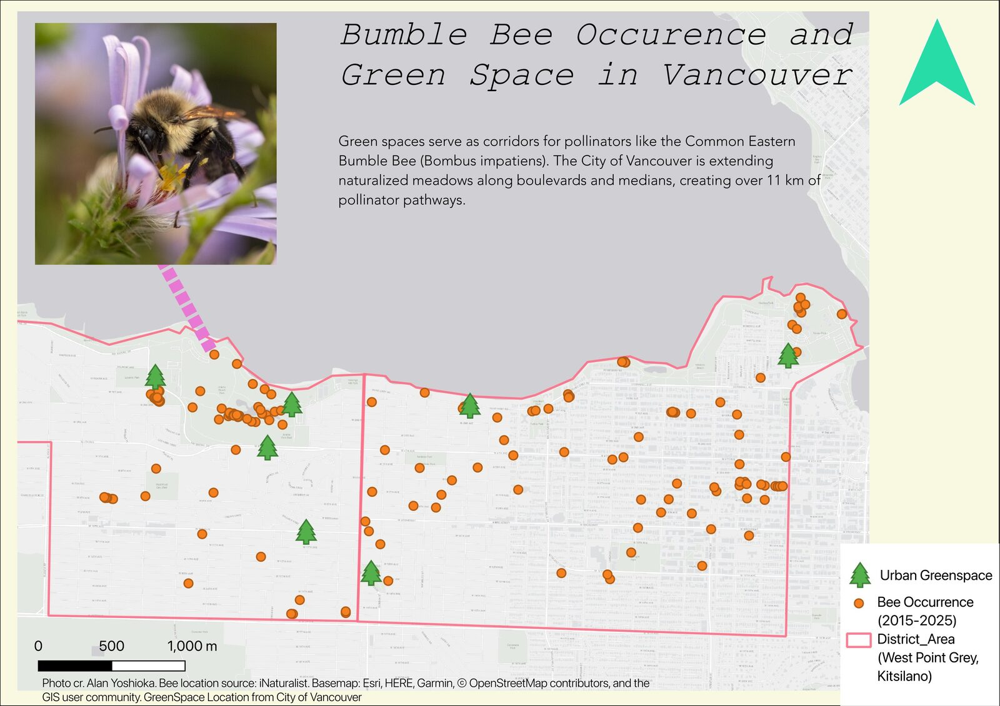
</a>
```

::: map-entry-text
My Conservation topic is about how green urban spaces may serve as corridors that support bumble bee occurrence. Pollinators are vital to our ecosystem because they facilitate the reproduction of the plants that provide food, shelter, and beauty, yet urban fragmentation is linked to their population decline. Pollinator pathways provide a solution by filling the gap between separated green areas, and green spaces may serve as corridors for bumble bees such as the Common Eastern Bumble Bee (Bombus impatiens). The City of Vancouver is extending naturalized meadows along boulevards and medians, creating over 11 km of pollinator pathways. My map shows seven City of Vancouver Green space locations and 209 bumble bee observations from iNaturalist, which are concentrated in West Point Grey and Kitsilano, where many points overlap near parks with higher vegetation abundance. This suggests that larger green space, such as parks and meadows, may be associated with more bumble bee occurrence. However, the observations are volunteer and presence-only records that depend on where people look, and seven locations are only a subset of the City's meadow sites. No statistical or movement analysis was done, so the map shows only an association but cannot show the green spaces function as corridors.

[Open full-resolution image](../img/events/maps_for_conservation/map-02.jpg){target="_blank"} · [Back to top](#){.back-top}
:::
:::

::: {#map-08 .map-entry}
## Forest-Area Change, 2000–2020: Paraguay and Brazil in Global Context {.unnumbered}

[Map 8 · Global]{.map-entry-meta}

```{=html}
<a href="../img/events/maps_for_conservation/map-05.jpg" class="map-figure" data-gallery="maps" data-glightbox="title: Map 8: Forest-Area Change, 2000–2020: Paraguay and Brazil in Global Context">
  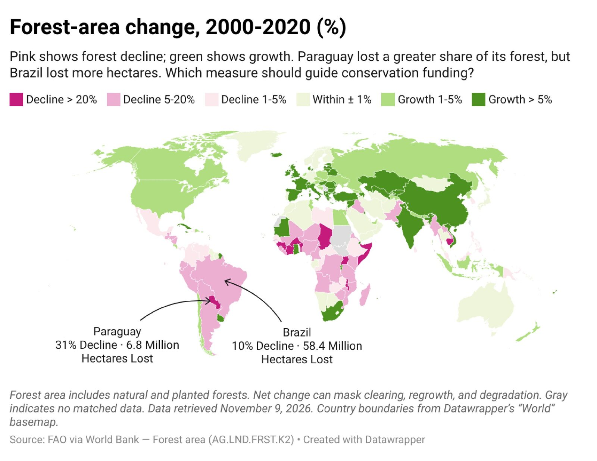
</a>
```

::: map-entry-text
Between 2000 and 2020, Paraguay lost 31% of its forest area, a net decline of 6.8 million hectares. Brazil lost 10%, a net decline of 58.4 million hectares. These figures raise a question for conservation funders: how much weight should they give to the share of forest a country has lost and how much to the number of hectares lost?

The map uses national forest-area data from the Food and Agriculture Organization of the United Nations (FAO), distributed through the World Bank. Colors show the percentage change from each country's forest area in 2000. The labels for Paraguay and Brazil show why the choice of measure matters: Paraguay experienced the steeper proportional decline, while Brazil lost more forest area overall.

The figures include both natural and planted forests. National totals can mask local clearing, regrowth, and changes in habitat quality. Funding decisions also depend on which habitats are at risk, what local communities prioritize, who holds land rights, and what a proposed project would cost.

**Sources Used:**

- Forest area: FAO via World Bank, World Development Indicators, AG.LND.FRST.K2, 2000 and 2020. Data retrieved November 9, 2026.
- Country boundaries: Datawrapper, World basemap.

[Open full-resolution image](../img/events/maps_for_conservation/map-05.jpg){target="_blank"} · [Back to top](#){.back-top}
:::
:::

::: {#map-09 .map-entry}
## Not All Marmots Get the Same Summer! {.unnumbered}

[Map 9 · Whistler, BC]{.map-entry-meta}

```{=html}
<a href="../img/events/maps_for_conservation/map-10.jpg" class="map-figure" data-gallery="maps" data-glightbox="title: Map 9: Not All Marmots Get the Same Summer!">
  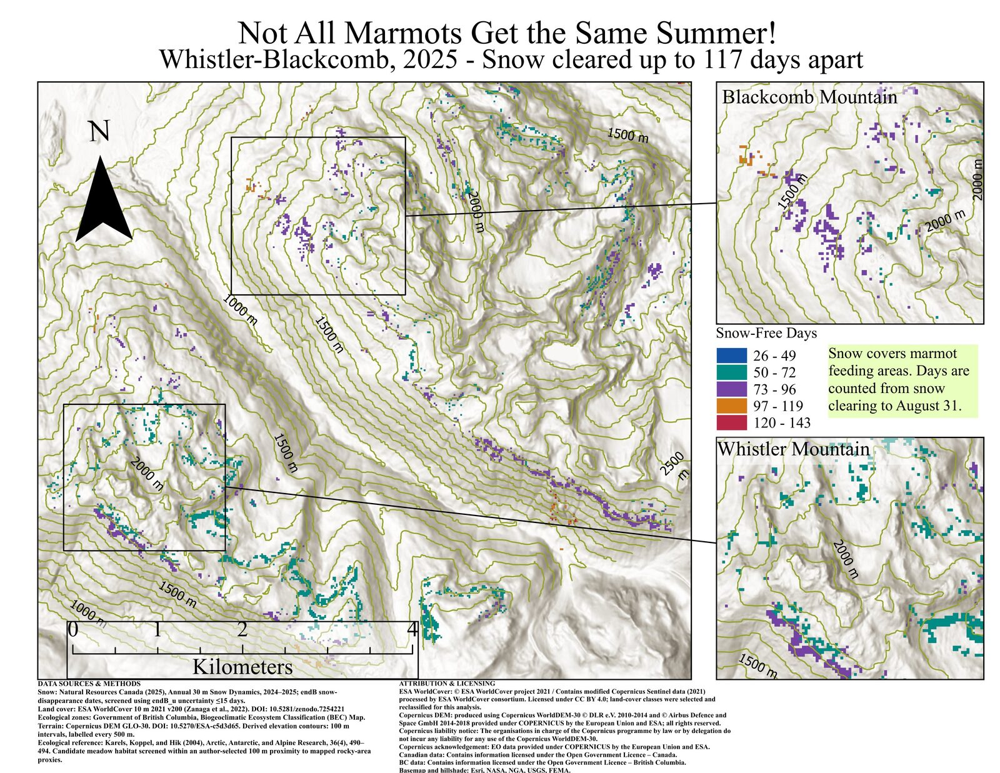
</a>
```

::: map-entry-text
For marmots, summer starts when the snow disappears---but not everywhere at once.

In the mountains around Whistler--Blackcomb, hoary marmots live in alpine environments where summer is short. Snow can cover alpine meadows well into the warmer months, limiting when vegetation becomes accessible.

This map explores how the timing of snow disappearance affects the time available for marmots to feed before August 31, 2025.

Using satellite snow data, land-cover information, and ecological zone mapping, I identified potential alpine meadows located near rocky areas where marmots may find shelter. I then calculated the number of snow-free days between the end of the main snow-cover period and August 31, 2025.

The mapped intervals range from 26 to 143 days, a difference of 117 days across the selected areas. Some meadows become exposed much earlier than others, creating differences in feeding time across the landscape.

As the climate warms, earlier snowmelt could increase the time available for foraging, but changing temperatures and moisture conditions could also affect alpine vegetation. Understanding where and when snow disappears can help us explore how climate change might influence future marmot habitat.

[Open full-resolution image](../img/events/maps_for_conservation/map-10.jpg){target="_blank"} · [Back to top](#){.back-top}
:::
:::

::: {#map-10 .map-entry}
## Living Slopes {.unnumbered}

[Map 10 · Central Java, Indonesia]{.map-entry-meta}

```{=html}
<a href="../img/events/maps_for_conservation/map-13.jpg" class="map-figure" data-gallery="maps" data-glightbox="title: Map 10: Living Slopes">
  
</a>
```

::: map-entry-text
Across the volcanic highlands of Central Java, farming livelihoods meet a terrain of cones, ridges and valleys. Living Slopes asks where cropland mapped in 2021 overlaps with steep terrain across Dieng, Prau, Sindoro and Sumbing.

The map combines ESA WorldCover with slope derived from Copernicus GLO-30 surface elevations. Four slope classes reveal a gradient rather than a single boundary of concern. Orange and rose identify steeper cultivated terrain around the Dieng uplands and along parts of the volcanic aprons. Most mapped cropland occupies gentler terrain; 12.4% lies on slopes of at least 25%, representing about 36 square kilometres across the study rectangle.

This overlap invites closer soil-conservation assessment with local communities. Ground cover, contour cultivation and runoff management are possible topics for discussion, alongside labour, costs and livelihood needs. Terrain and land cover alone do not establish erosion rates, existing management quality or groundwater connections.

The 2021 classification cannot identify individual crops or describe present conditions. Surface elevations also include vegetation and structures. These limitations, together with sensitivity to slope thresholds, make the map a transparent starting point for local investigation and shared conservation choices.

[Open full-resolution image](../img/events/maps_for_conservation/map-13.jpg){target="_blank"} · [Back to top](#){.back-top}
:::
:::

::: {#map-11 .map-entry}
## Sea Ice Concentration Change Across Canada's Polar Bear Subpopulations {.unnumbered}

[Map 11 · Canadian Arctic]{.map-entry-meta}

```{=html}
<a href="../img/events/maps_for_conservation/map-01.jpg" class="map-figure" data-gallery="maps" data-glightbox="title: Map 11: Sea Ice Concentration Change Across Canada's Polar Bear Subpopulations">
  
</a>
```

::: map-entry-text
Recent reports warning that polar bears could face severe population declines by the end of this century inspired me to explore how their Arctic habitat has changed over time. My map was also inspired by the sea-ice analysis published by the Copernicus Climate Change Service, which highlights long-term changes in Arctic sea-ice conditions. As Canada is home to many of the world's polar bears, understanding these changes is particularly important for conservation.

This map compares average September sea-ice concentration across 14 Canadian polar bear subpopulations during two periods: 1981--1990 and 2016--2025. September was selected because Arctic sea ice typically reaches its annual minimum during this month. Using satellite-derived data, the map illustrates how sea-ice concentration has changed over approximately four decades.

The results highlight substantial declines in several subpopulation regions, particularly the Gulf of Boothia and Beaufort Sea areas. Sea ice provides essential habitat for polar bears to travel and hunt seals, their primary food source. Declining sea-ice conditions may therefore threaten their long-term survival.

Through this map, I hope to raise awareness of the changing Arctic environment and the importance of polar bear conservation.

[Open full-resolution image](../img/events/maps_for_conservation/map-01.jpg){target="_blank"} · [Back to top](#){.back-top}
:::
:::

::: {#map-12 .map-entry}
## Average Age of Trees on Southwest Vancouver Island {.unnumbered}

[Map 12 · Vancouver Island, BC]{.map-entry-meta}

```{=html}
<a href="../img/events/maps_for_conservation/map-03.jpg" class="map-figure" data-gallery="maps" data-glightbox="title: Map 12: Average Age of Trees on Southwest Vancouver Island">
  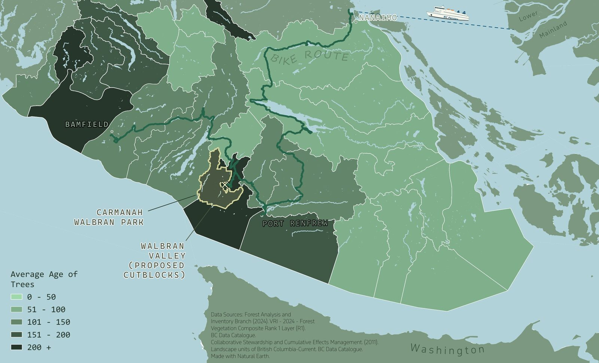
</a>
```

::: map-entry-text
The following map attempts to display the crisis of old-growth in this province I experienced firsthand after biking to Bamfield BC this past summer.

Maps do a great job at displaying cumulative effects or disturbances at scale, but it's hard to convey the magic of light and dark dancing through the canopy, or the awe you feel craning your head so far backwards you fall over to get a mere glimpse of the top of these trees. It's hard to capture that by querying "projected age at over 140 years old". Some of the trees I saw this summer were over 1000 years old.

This map summarizes the average age of trees found in the VRI joined to each landscape unit. Although the commenting period has closed, I felt compelled to make a map of this transformative trip, as four cutblocks have been proposed in the Central Walbran, highlighted on my map. The Central Walbran is in Pacheedaht territory, and is an ecologically, and culturally significant area of high-productivity old-growth. This map is my small effort in telling the story of a small chunk of the 35,000 ha or 350km2 of productive old-growth forest that is so threatened.

Price, K., Holt, R. F., & Daust, D. (2020, April). *BC's old growth forest: A last stand for biodiversity*. Veridian Ecological Consulting. <https://veridianecological.ca/wp-content/uploads/2020/05/bcs-old-growth-forest-report-web.pdf>

[Open full-resolution image](../img/events/maps_for_conservation/map-03.jpg){target="_blank"} · [Back to top](#){.back-top}
:::
:::

::: {#map-13 .map-entry}
## Land Use and Land Cover Dynamics in Chittagong District (2019–2024) {.unnumbered}

[Map 13 · Chittagong, Bangladesh]{.map-entry-meta}

```{=html}
<a href="../img/events/maps_for_conservation/map-06.jpg" class="map-figure" data-gallery="maps" data-glightbox="title: Map 13: Land Use and Land Cover Dynamics in Chittagong District (2019–2024)">
  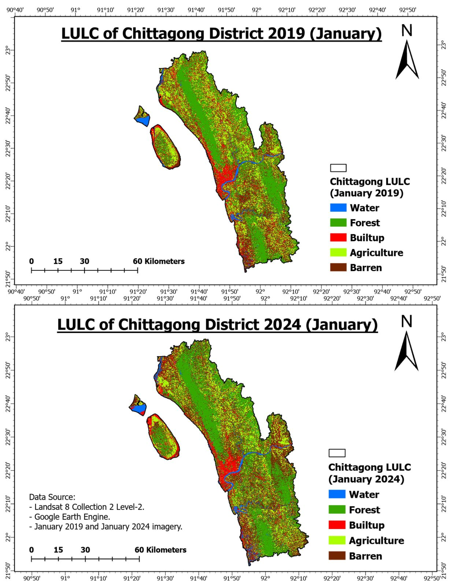
</a>
```

::: map-entry-text
This map illustrates the spatial distribution and changes in five major land use and land cover (LULC) classes ---water bodies, forests, built-up areas, agriculture, and barren land---in Chittagong District, Bangladesh, between January 2019 and January 2024. The primary objective is to examine the changing landscape patterns and highlight their potential implications for environmental sustainability and natural resource conservation.

The analysis was conducted using Landsat 8 Collection 2 Level-2 satellite imagery for January 2019 and January 2024. Google Earth Engine (GEE) was used for image processing and Random Forest supervised classification to generate the LULC maps. The resulting classifications were subsequently prepared and presented in a comparative cartographic layout to illustrate the spatial distribution of different land cover categories over the five years.

The maps provide a visual understanding of landscape transformation, particularly the distribution of forest cover and the expansion of built-up areas. Such spatial information can support environmental monitoring, sustainable land management, forest conservation planning, and informed decision-making. This study demonstrates the value of satellite remote sensing and GIS in identifying land-cover dynamics and supporting conservation-oriented environmental management in Bangladesh.

[Open full-resolution image](../img/events/maps_for_conservation/map-06.jpg){target="_blank"} · [Back to top](#){.back-top}
:::
:::

:::
